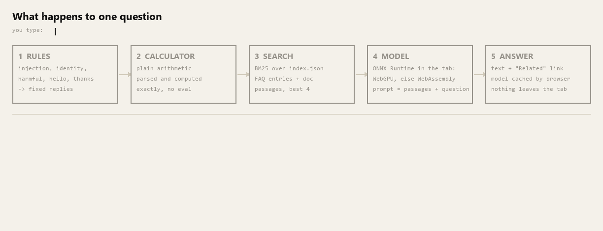

# Architecture



PocketBot has two halves that never run at the same time:

- **Build time** (your computer, once per change to your knowledge): turns `knowledge/` into a model file and a search index.
- **Run time** (the visitor's browser, every question): static files in, answer out. There is no server process and no network call after the files are cached.

```
BUILD TIME (Python, a CUDA GPU)                                    RUN TIME (the browser tab)

knowledge/faq.txt ─┐                                               question
knowledge/docs/*  ─┼─ 01_build_data ─> train.jsonl / val.jsonl        │
pocketbot.toml    ─┘                         │                      rules ──────────────> fixed reply (injection, identity, harmful, hello, thanks)
                                   02_train --stage sft             │
base model ────────────────────────────>  fine-tuned                calculator ───────> exact sum
(SmolLM2-135M-Instruct)                      │                      │
                                   02_train --stage qat             search (BM25) ──> top passages from index.json
                                             │                      │
                                   03_export  (ONNX, 4-bit)         model (ONNX Runtime: WebGPU, else WebAssembly)
                                             │                      │   prompt = system prompt + passages + question
                          model_q4.onnx + tokenizer                 │   greedy decoding with a KV cache, <= 100 tokens
                                             │                      │
knowledge ───── 05_build_web ───> dist/  (static folder) ───────>   answer + "Related" link
```

## Run-time components (`web/pocketbot.js`)

| Layer | What it does | Why it exists |
|---|---|---|
| **Rules** | Regular expressions for prompt-injection phrasing, "who made you / which model are you", harmful requests ("write ransomware"), greetings and thanks. Returns the fixed replies from `pocketbot.toml`. | A 135M model cannot be trusted to refuse reliably or to keep a persona under pressure. These cases are cheap to detect and expensive to get wrong, so code handles them before the model sees the text. The training data teaches the model the same replies as a second line of defence. |
| **Calculator** | A small recursive-descent parser for `+ - * / ^` and brackets. No `eval`. | A model this size guesses digits. Plain arithmetic is answered exactly. |
| **Search** | BM25 keyword search over `index.json` (one passage per FAQ entry, plus chunks of `knowledge/docs`). Words in an entry's questions count three times. A passage must contain 40% of the question's informative words. FAQ entries and document passages are ranked in separate pools so neither crowds out the other. | The model is too small to memorise your facts reliably. It is trained to answer *from the passages it is given*. Keyword search needs no embedding model, no API, and a few lines of JavaScript. Its weakness is vocabulary mismatch ("fee" vs "cost"); the `aliases` table in `pocketbot.toml` and extra `Q:` lines in `faq.txt` are the fix. |
| **Model** | The fine-tuned, 4-bit model, run with ONNX Runtime Web. WebGPU if the browser has it, otherwise WebAssembly on the CPU. Greedy decoding, KV cache, at most 100 new tokens, stops at `<|im_end|>`. | The part that turns passages into a sentence in the bot's voice and decides when to say "I don't see that". |
| **Post-processing** | If the model refuses but search found a passage that covers 80% of the question, show that passage instead. Append a "Related" link when a document passage with a URL was used. | The model is sometimes over-cautious. Showing the source is better than a wrong refusal and lets the reader check the answer. |
| **Cache** | The model file is stored with the browser's Cache Storage, keyed by `model.version`. | The 89 MB download happens once per browser. |

### Backends

`load()` asks the browser for a WebGPU adapter. If it gets one it starts a session with the `webgpu` execution provider and runs a 2-token warm-up (this compiles the GPU shaders and proves the GPU path works). If anything fails it starts a plain WebAssembly session instead. Add `?nogpu` to the page URL to force the CPU. The attention cache (`present.*` outputs) stays in GPU memory between tokens; copying it to the CPU and back every token doubled the time per token in our measurements. WebAssembly runs on one thread unless the page is cross-origin isolated (`Cross-Origin-Opener-Policy` and `Cross-Origin-Embedder-Policy` headers), which most sites cannot set because it breaks embedded third-party content.

## Build-time components (`scripts/`)

| Script | Input -> output | Notes |
|---|---|---|
| `01_build_data.py` | `knowledge/*`, `pocketbot.toml` -> `build/data/{train,val}.jsonl` | Chat-format examples. Each FAQ entry appears with no context, with context (the right entry mixed with 0-2 distractors, shuffled, like real search results), and once with an unrelated context where the correct answer is the "unknown" reply. Plus fixed-reply examples and exact arithmetic. |
| `02_train.py --stage sft` | base model -> `build/ckpt/sft` | Full fine-tune (all weights), fp16 autocast, AdamW, cosine schedule. Loss only on the assistant's tokens. Keeps the epoch with the lowest validation loss. |
| `02_train.py --stage qat` | `build/ckpt/sft` -> `build/ckpt/qat` | Quantization-aware training. The same data again, with every Linear layer and the tied embedding rounded to the 4-bit grid in the forward pass (straight-through gradient). The weights move to values that survive the final rounding. |
| `03_export.py` | `build/ckpt/qat` -> `build/model/model_q4.onnx` | `optimum` exports an fp32 ONNX graph with a KV cache and checks it against PyTorch. The script then replaces every weight matrix with a `MatMulNBits` node (4-bit) and rewrites the embedding (below). |
| `04_evaluate.py` | model + `knowledge/probes.json` -> pass counts | Questions in wording that is not in `faq.txt`. |
| `05_build_web.py` | everything -> `dist/` | Copies the model, tokenizer, runtime libraries, search index and `bot.config.json` into one static folder. |

### The 4-bit format

`scripts/quant.py` holds the rounding rule, and both training and export import it (a test checks that the PyTorch and NumPy versions give identical values).
Weights are cut into blocks of 32 along the input dimension. Each block has one float scale. The block's largest-magnitude weight, keeping its sign, maps to integer -8: `scale = extreme / -8`, `q = clip(round(w / scale), -8, 7)`. Values are stored as `q + 8` in nibbles, two per byte, first value in the low nibble. This is the layout ONNX Runtime's `MatMulNBits` operator expects with its default zero point of 8.
Using the block's extreme as the anchor rather than `max(abs)/7` matters: it uses the full -8..7 range and gave about 3 points more next-token accuracy than the naive `max(abs)/7` rule in our tests.

### The shared embedding

SmolLM2 ties its input embedding table (49,152 x 576) to its output layer. In fp32 that table alone is 113 MB. `03_export.py` quantizes it once and uses it twice:

- **Output layer:** the packed table is exactly the `B` input of a `MatMulNBits` node (rows = vocabulary, columns packed along the hidden dimension).
- **Token lookup:** `Gather` rows of the packed bytes, then unpack with `Cast`, `BitShift`, `Sub`, `Concat`, `Reshape`, `Mul` by the gathered scales. All standard operators, so it runs on both the WebGPU and WebAssembly builds.

It also slices the hidden state to the last position before the output layer, so a prompt of 300 tokens does not compute 300 x 49,152 logits that are never used.

## Files you may need to read

- `pocketbot.toml`: bot identity, fixed replies, training hyper-parameters, runtime settings.
- `knowledge/faq.txt`: `@@ category | weight`, one or more `Q:` lines, an `A:` line.
- `dist/bot.config.json`: generated. System prompt, replies, model layout (layers, KV heads, head size), runtime settings.
- `dist/index.json`: generated. `{chunks: [{k:'qa'|undefined, t, h, q, x, w, u}]}`.

## Failure modes to expect

- **Vocabulary mismatch** in search (see above).
- **Over-refusal:** the model says "I don't see that" although the passage was in the prompt. More paraphrased `Q:` lines help; the 80%-coverage fallback catches some of it.
- **Rambling** when search returns nothing useful and the model improvises. Output is capped at 100 tokens and cut at the last full sentence.
- **Facts the model half-remembers.** It was trained on your FAQ, so it may produce a plausible but wrong number from memory when the passage is missing. Keep answers short, keep one fact per entry, and treat the answers as unverified.
- **Slow generation on CPU:** about 0.4 s per token measured on one machine.
