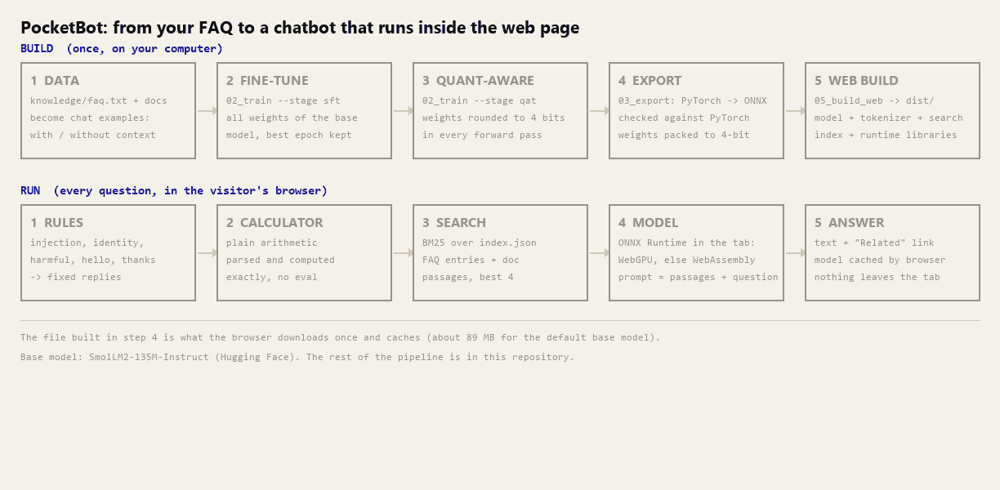

# Pipeline: from your text to a file the browser runs



Run everything from the repository root. Measured on the sample bot with an RTX 2060 (6 GB): fine-tune 8 min, 4-bit-aware stage 7 min, export about 1 min, evaluation about 5 min on the CPU. About 20 minutes in total.

## 0. One-time setup

```bash
python -m venv .venv && source .venv/bin/activate        # Windows: .venv\Scripts\activate
pip install torch --index-url https://download.pytorch.org/whl/cu128   # a CUDA build; pick yours at pytorch.org
pip install -r requirements.txt
```

You need an NVIDIA GPU with about 6 GB of memory for training. A free Colab T4 works too. Nothing else in the pipeline needs a GPU, and the finished bot runs on any recent browser.
Node.js 18+ is needed once, by `scripts/fetch_runtime.py`, to download the two browser libraries.

## 1. Describe your bot and your knowledge

Edit `pocketbot.toml` (name, system prompt, fixed replies) and `knowledge/faq.txt` (questions and answers). Optionally add documents to `knowledge/docs/`.
Aim for at least 40 FAQ entries with 2-4 `Q:` phrasings each. The sample has 28 entries and is deliberately small. See `CUSTOMIZING.md`.

## 2. Build the training data

```bash
python scripts/01_build_data.py
```
Writes `build/data/train.jsonl` and `val.jsonl`. Open a few lines and read them: this file is what the model will learn, so mistakes in it become mistakes in the bot.

## 3. Fine-tune

```bash
python scripts/02_train.py --stage sft
```
Prints train and validation loss per epoch and keeps the best epoch. Validation loss should fall, then flatten. If it rises while training loss keeps falling, the model is memorising; lower `[train] epochs`.

## 4. Quantization-aware fine-tune

```bash
python scripts/02_train.py --stage qat
```
Continues from step 3 with 4-bit rounding in the forward pass. The first validation loss it prints is higher than the end of step 3 (that is the cost of rounding); it should come most of the way back.

## 5. Export and pack

```bash
python scripts/03_export.py
```
Runs `optimum` (it prints the maximum difference against PyTorch; around 1e-4 is normal) and writes `build/model/model_q4.onnx` (about 89 MB for the default model).

## 6. Evaluate

```bash
python scripts/04_evaluate.py --show
```
Runs the questions in `knowledge/probes.json` through the exported model with the correct passage supplied. This tests the model's behaviour, not search. Edit the probes to match your own topic, and keep their wording different from `faq.txt`.
For a number you can compare across runs: `python scripts/03_export.py --all-logits && python scripts/04_evaluate.py --token-accuracy`.

## 7. Build the website folder and try it

```bash
python scripts/05_build_web.py
python -m http.server 8000 -d dist
```
Open `http://localhost:8000/demo.html`. Downloading the runtime libraries (about 45 MB) happens on the first build. Copy `dist/` to any static host to publish it.

## Retraining after changes

| You changed | Run again |
|---|---|
| Only `[runtime]` settings or `aliases` | `05_build_web.py` |
| `faq.txt` or `knowledge/docs` | everything from step 2, then bump `[model] version` |
| Fixed replies or system prompt | everything from step 2, then bump `version` |
| Hyper-parameters | steps 3 to 5 |

Bumping `version` makes browsers fetch the new model instead of using the cached one.

## Troubleshooting

- **"No CUDA GPU found"**: install a CUDA build of PyTorch, or train on Colab and copy `build/ckpt/qat` back.
- **Out of memory during training**: lower `[train] batch` (and raise `accum` to keep the same effective batch) or `max_len`.
- **`optimum-cli` not found**: it is installed next to the Python in your virtual environment; activate the environment.
- **Export fails with a tokenizer error**: you have transformers 5.x. Install the pinned version from `requirements.txt`.
- **Page loads but never answers (browser)**: open the console. A `wasm` MIME error means the host serves `.wasm` incorrectly (`application/wasm` is required). A CSP error means your site's Content-Security-Policy needs `'wasm-unsafe-eval'` in `script-src`.
- **The model repeats a wrong fact from your FAQ**: look for two entries that disagree, then retrain.
